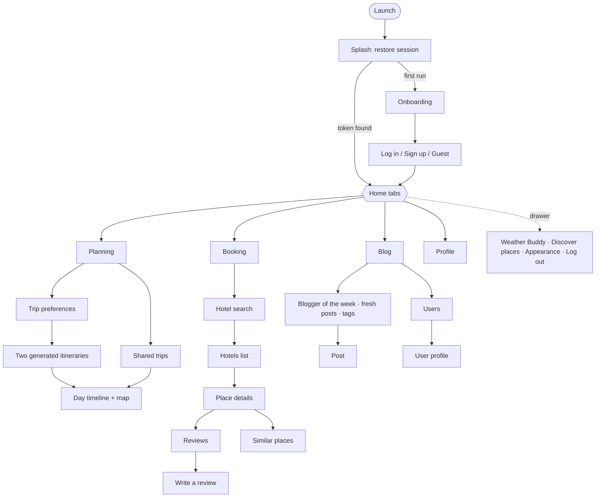

<p align="center">
  
</p>

<h1 align="center">TripPal</h1>

<p align="center">
  A Flutter travel planning app: automatic multi-day itineraries, places and hotels with reviews,
  interactive maps, a travel blog and a weather companion.
</p>

<p align="center">
  
  
  
  
  
</p>

> 🖥️ **Backend:** the Django REST API this app talks to lives in its own repository –
> **[MuhammadNsearaty/trippal-backend](https://github.com/MuhammadNsearaty/trippal-backend)**.

## Features

- **Automatic trip planning** – pick cities, place types (historic, cultural, natural, religious, sport,
  architecture), food / shopping and trip mode (*Extended* or *Focused*); the backend planner returns two
  alternative itineraries you can swipe between and compare.
- **Trip plans** – day-by-day timeline of activities, a Google Map of each day, and a list of trips shared by
  other travellers with sorting and filters (start date, number of days).
- **Places & hotels** – browse and search the places database, filter and sort hotels (rating, reviews,
  distance to centre), place details with rating statistics, properties and *"places like this"*
  recommendations.
- **Reviews** – read reviews with date / rating filters and write your own star rating and review.
- **Travel blog** – blogger of the week, fresh posts, tags, posts by tag and a users directory with public
  profiles.
- **Weather Buddy** – follow the weather of up to 6 places (OpenWeatherMap) with place search powered by
  Photon geocoding.
- **Accounts** – onboarding, sign up, log in, guest mode, token based sessions that survive restarts, and
  device registration for push notifications (Firebase Cloud Messaging).
- **Light and dark themes**, portrait layout tuned for phones.

## App flow



## Screenshots

<!--
Add phone screenshots to docs/screenshots/ and uncomment this table.

| Onboarding | Home | Trip plan | Place details | Blog |
|---|---|---|---|---|
|  |  |  |  |  |
-->

*Screenshots coming soon.* To capture them, run the app on an emulator and use
`flutter screenshot --out docs/screenshots/<name>.png`.

## Tech stack

| Area | Packages |
|---|---|
| State, routing, DI | [GetX](https://pub.dev/packages/get), [get_storage](https://pub.dev/packages/get_storage) |
| Networking | [dio](https://pub.dev/packages/dio) wrapped in a small typed client (`lib/utilities/networking_utils.dart`) |
| Maps & location | [google_maps_flutter](https://pub.dev/packages/google_maps_flutter), [location](https://pub.dev/packages/location), [flutter_polyline_points](https://pub.dev/packages/flutter_polyline_points) |
| Notifications | [firebase_messaging](https://pub.dev/packages/firebase_messaging), [flutter_local_notifications](https://pub.dev/packages/flutter_local_notifications) |
| UI | [fl_chart](https://pub.dev/packages/fl_chart), [cached_network_image](https://pub.dev/packages/cached_network_image), [shimmer](https://pub.dev/packages/shimmer), [flutter_staggered_grid_view](https://pub.dev/packages/flutter_staggered_grid_view), [flutter_svg](https://pub.dev/packages/flutter_svg), [animated_text_kit](https://pub.dev/packages/animated_text_kit) |
| External APIs | TripPal backend, [OpenWeatherMap](https://openweathermap.org/api), [Photon](https://photon.komoot.io/) geocoding |

## Project structure

```
lib/
  main.dart          app entry: storage, notifications, theme, initial bindings
  pages.dart         named routes, bindings and route middleware
  controllers/       GetX controllers (lists with paging / sorting / filters, trips, weather, profile ...)
  models/            data models and JSON (de)serialization
  services/          backend API views, auth, Firebase messaging, notifications, weather, geocoding
  screens/           UI grouped by feature (boarding, credentials, home, planing, details, review, weather_buddy ...)
  widgets/           reusable and animated widgets
  dialogs/           error, filter, review and theme dialogs
  utilities/         constants, networking client, error handling, themes, sizing helpers
assets/              images, onboarding art, weather illustrations, fonts
```

## Getting started

### Requirements

- **Flutter 2.x** (Dart `>=2.12 <3.0`). The dependencies date from 2021, so a Flutter 2 release
  (for example 2.5 or 2.10, easy to pin with [fvm](https://fvm.app/)) is the safest choice.
- Android SDK with an emulator or a device. Android is the configured platform; iOS still needs its own
  Firebase and Google Maps setup.
- A running [TripPal backend](https://github.com/MuhammadNsearaty/trippal-backend).

### 1. Clone and install

```bash
git clone https://github.com/MuhammadNsearaty/TripPal.git
cd TripPal
flutter pub get
```

### 2. Add your keys (kept out of git)

| What | Where |
|---|---|
| Firebase config for push notifications | `android/app/google-services.json` (download it from your Firebase project, package `com.example.trip_pal_null_safe`) |
| Google Maps Android API key | `android/local.properties` → `MAPS_API_KEY=your-key` |
| OpenWeatherMap key (Weather Buddy) | `--dart-define=OPENWEATHER_API_KEY=your-key` |

`android/local.properties` and `google-services.json` are git-ignored, so never commit them.

### 3. Point the app at your backend

The server address is chosen at build time:

| Define | Default | Description |
|---|---|---|
| `API_HOST` | `trippal-server.herokuapp.com` | host and optional port of the backend |
| `API_USE_HTTPS` | `true` | set to `false` for a local HTTP server |

```bash
# backend running locally (python manage.py runserver 0.0.0.0:8000), Android emulator
flutter run \
  --dart-define=API_HOST=10.0.2.2:8000 \
  --dart-define=API_USE_HTTPS=false \
  --dart-define=OPENWEATHER_API_KEY=your-key
```

On a real device use your computer's LAN IP instead of `10.0.2.2`. Plain HTTP is only allowed in debug
builds, so production builds should use an HTTPS backend.

### Release build

Create `android/key.properties` (`storePassword`, `keyPassword`, `keyAlias`, `storeFile`) for signing, then:

```bash
flutter build apk --release --dart-define=API_HOST=api.example.com --dart-define=OPENWEATHER_API_KEY=your-key
```

## Backend API used

All requests go to `/api/` on the backend and authenticated ones send `Authorization: Token <token>`.

| Feature | Endpoints |
|---|---|
| Auth | `POST /login/`, `POST /register/`, `GET /users/logout/`, `PUT /devices/update/` |
| Places & hotels | `GET /places-db/`, `GET /hotels-db/`, `GET /places-db/{id}/` |
| Reviews | `GET /places-review/?place={id}`, `POST /places-review/` |
| Trips | `GET /trips/`, `GET /trips/{id}/`, `POST /trips/auto/` |
| Blog | `GET /blogs/`, `GET /blogs/{id}/`, `GET /blogs/blogger-of-week/`, `GET /tags/`, `GET /users/{id}/` |

See the backend's Swagger docs (`/api/swagger/`) for the full contract.

## Credits

Built as a team project by [Nitro963](https://github.com/Nitro963), [amgad123](https://github.com/amgad123) and
[MuhammadNsearaty](https://github.com/MuhammadNsearaty).
